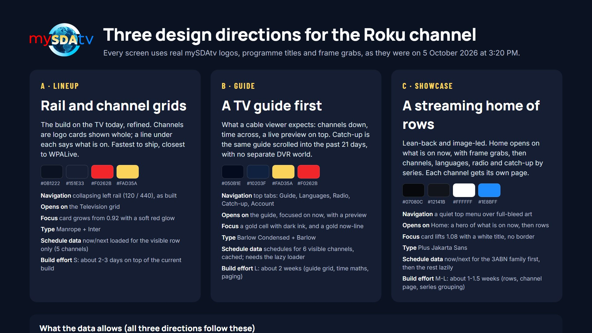

# mySDAtv: design systems

There are three design systems for the Roku channel, proposed on 2026-10-06. They are built on the metadata the feeds actually carry; see [data-brief.md](data-brief.md).

| System | Idea | Status (owner, 2026-10-06) |
|---|---|---|
| [C · Showcase](showcase.md) | Streaming home of rows, channel pages, catch-up by series | **Final.** Floating capsule nav on the left, whole logo, screen titles. First to build. |
| [A · Lineup](lineup.md) | Rail and channel grids; today's build, refined | **Final: α "Ink and ember".** All 8 screens drawn. |
| [B · Guide](guide.md) | TV guide first; catch-up is the guide scrolled backwards | Shapes final (B-1). Navigation: G1 and G2 are both drawn on all 8 screens; **pick pending**. |

## Final screens: one folder per system

| System | Folder (1920x1080 JPEGs) | Contact sheet |
|---|---|---|
| C · Showcase | `showcase/` (C1-C8) | [sheet-C-Showcase-v3.jpg](showcase/sheet-C-Showcase-v3.jpg) |
| A · Lineup α | `lineup/alpha/` (AX1-AX8) | [sheet-A-alpha.jpg](lineup/alpha/sheet-A-alpha.jpg) |
| B · Guide G1 (category spine) | `guide/g1/` (BG1-1 to BG1-8) | [sheet-B-G1.jpg](guide/g1/sheet-B-G1.jpg) |
| B · Guide G2 (channel list + day timeline) | `guide/g2/` (BG2-1 to BG2-8) | [sheet-B-G2.jpg](guide/g2/sheet-B-G2.jpg) |

Everything else in these folders (`options/`, `nav-options/`, `rethink/`, and the first-version JPEGs at the top of `lineup/` and `guide/`) is history, kept for reference.

## Where things live

- **Screenshots:** 1920x1080, the Roku design plane. They are in `showcase/`, `lineup/` and `guide/`, one per screen plus a `sheet-*` contact sheet.
- **Board sources:** `source/*.dc.html`, plus `canvas.json`. The live canvas is https://claude.ai/artifact/6K9kvGm1nFZhpxBHEstXVm (private to the owner).
- **Re-rendering locally:** copy `source/render-support.js` as `support.js` beside the boards, point `/_blob/<id>` at local asset files, and run headless Chrome with `--screenshot --window-size=1920,1080`. The asset ids are listed in the task folder `docs/team/tasks/2026-10-06-three-design-directions/`.

## Rules every system follows (from the data)

- **Logos.** Logos are 225x160 PNGs on white. Show them whole, at 1.41, on a light plate. Never crop them to 16:9.
- **Programme titles.** Only the 3ABN family publishes titles. Every other channel shows "Live now · 3 PM hour", never "Program".
- **Frame grabs.** They are 320x180, so show them sharp at 480 px wide at most; behind content, blur them. Not-yet-aired slots show the logo and time, never a thumbnail. Every frame card carries the channel logo.
- **Text.** There are no descriptions anywhere, so text is titles and times only.
- **Schedule loading.** The schedule is about 377 KB per channel. Load it only for the channels on screen, or get a now/next endpoint.
